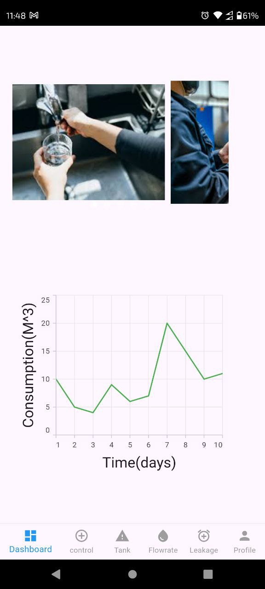
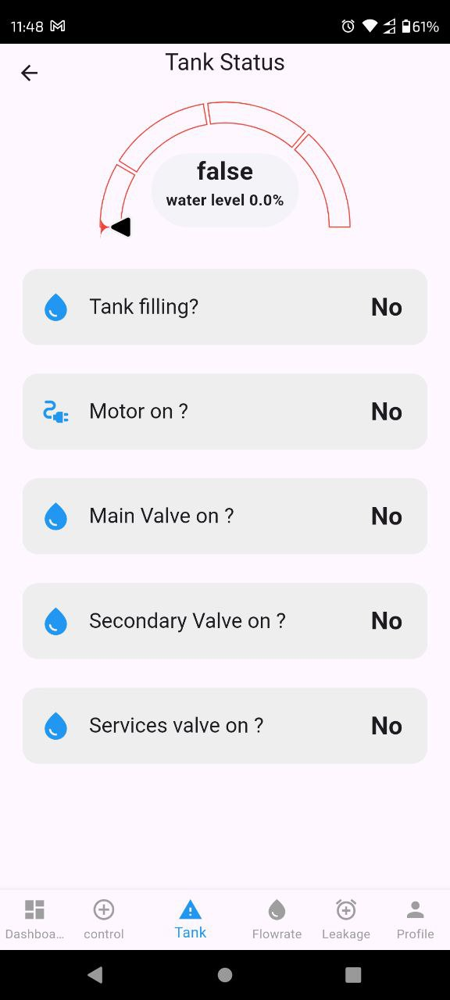

# Smart Water Monitoring System

A Flutter mobile app for monitoring and controlling a household water system: tank level, flow rate, consumption, leaks, and remote control of valves and the pump.

This is my graduation project for the B.Sc. in Electrical Engineering (Computers Division) at Fayoum University, 2025. It was graded Excellent. I developed the mobile application in Flutter and Dart. The system as a whole combines sensors and actuators on the water line with this app on top.

## Screenshots





## What the app does

- Shows live readings for tank level, flow rate and pressure
- Tracks water consumption and plots it over time
- Alerts you with a push notification when a leak is detected
- Opens and closes valves and switches the pump on and off remotely
- Supports manual control and an automatic mode
- Shows a clear banner when the phone loses its connection
- Keeps you signed in between sessions

## How it works

Live sensor data and control commands travel over MQTT, so readings update without polling. The app uses the `mqtt_client` package for this.

Sign-in and data requests go to a backend over HTTP using Dio. The app stores the session token locally and checks its expiry before using it.

Leak alerts are delivered through Firebase Cloud Messaging, so they reach the phone even when the app is closed.

State is handled with Bloc. Errors from the data layer are returned as `Either` values (dartz) instead of being thrown, which keeps the UI code simple.

## Tech stack

| Area | What I used |
| --- | --- |
| App | Flutter, Dart (SDK ^3.6) |
| State management | flutter_bloc |
| Live data | MQTT (`mqtt_client`) |
| HTTP | Dio |
| Notifications | Firebase Cloud Messaging |
| Charts and gauges | Syncfusion Flutter Charts, gauge_indicator |
| Local storage | shared_preferences, jwt_decoder |
| Connectivity | flutter_offline |
| Error handling | dartz |

## Running it locally

You need the Flutter SDK installed and an Android emulator or a device.

```bash
git clone https://github.com/RedaEssawy/SmartWater-Graduation-Project.git
cd SmartWater-Graduation-Project
flutter pub get
flutter run
```

Push notifications need your own Firebase project. Create one, register the Android app, and place its `google-services.json` in `android/app/`. You can also regenerate `lib/firebase_options.dart` with the FlutterFire CLI.

The MQTT broker address and the backend URL are specific to my setup, so point them at your own before running against live data.

## Repository layout

```
lib/        app source code
assets/     images and icons used in the UI
android/    Android project
ios/        iOS project
test/       tests
```

## Author

Reda Eid
[GitHub](https://github.com/RedaEssawy) · reda.eid.essawy@gmail.com
